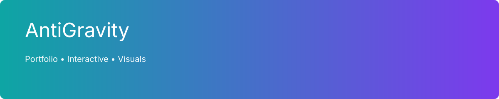
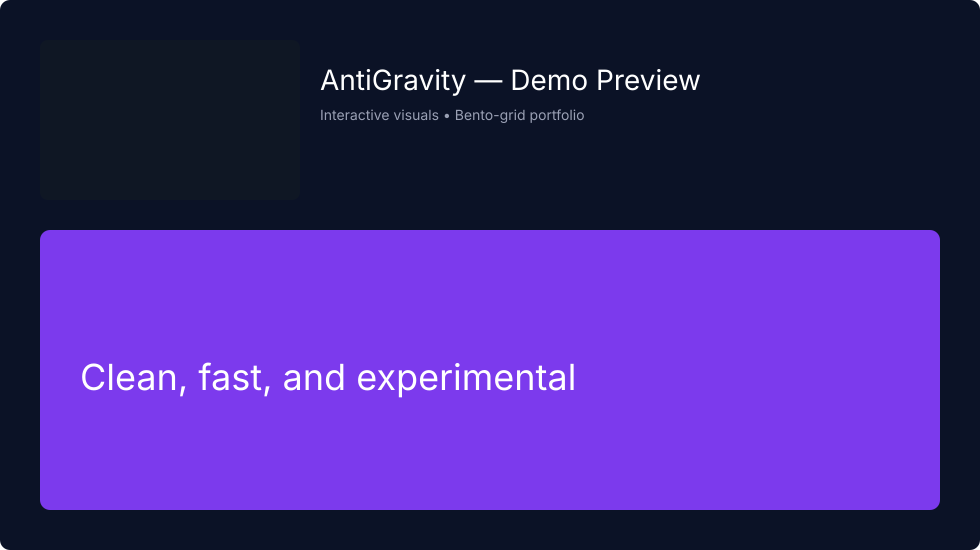

# AntiGravity — Portfolio & Interactive Demo

[Live demo](https://antigravity-portfolio-fawn.vercel.app/) — Hosted on Vercel

<p align="center">
  
</p>

A modern, high-performance single-page portfolio and interactive demo built to showcase experiments, projects, and educational resources. This repository powers the live site above and is optimized for visual impact, fast load times, and easy redeployment on Vercel or any static host.

---

## Key highlights
- Striking Hero section with animated/visual background for immediate impact
- Bento-grid project gallery with hover and entrance animations
- Downloadable developer roadmaps (PDFs) for learners
- Lightweight AI chat widget for quick portfolio questions
- Responsive, mobile-first design with smooth micro-interactions

---

## Live pages & sections
- Hero / Intro
- About / Overview
- Projects / Showcase (Bento grid tiles)
- Developer Roadmaps (PDF downloads)
- Contact / Connect (form / links)

---

## Tech stack (observed)
- HTML5, CSS3, JavaScript (vanilla)
- Styling: Tailwind-like utilities / modern CSS (project includes custom styles)
- Animations: CSS transitions + JS driven micro-interactions
- Hosting / Deploy: Vercel (auto-deploys on push)
- No backend required — static site deployable anywhere

---

## Example project preview
Below is a demo preview used for the README. Replace `assets/demo.svg` with a real screenshot or GIF (`assets/demo.png` / `assets/demo.gif`) for a richer repository preview.

<p align="center">
  
</p>

---

## Project structure

```text
antigravity-portfolio/
├── index.html         # main single-page site
├── style.css          # styles and layout
├── script.js          # interactions, chat logic, and animations
├── assets/            # images, SVGs, demo GIFs, banner
├── pdfs/              # roadmap PDF files
├── README.md          # this file
└── LICENSE            # license (recommended: MIT)
```

---

## Run locally
This project is static — no build step required unless you add a bundler.

1. Clone the repo

```bash
git clone https://github.com/aklilut40-code/antigravity-portfolio.git
cd antigravity-portfolio
```

2. Serve locally with a simple static server (Python example)

```bash
# Python 3
python -m http.server 8000
# then open http://localhost:8000
```

Or use any static server (live-server, http-server, etc.).

If you add a Node-based toolchain (Vite, webpack), follow that project's README.

---

## Recommended improvements (quick wins)
- Add high-quality GIF or PNG previews in `/assets` for immediate visual appeal on GitHub.
- Add semantic HTML and aria labels to interactive elements to improve accessibility.
- Include a small `screenshot-1200x675.png` in `/assets` for rich link previews and a better README hero.
- Add an MIT License and a short CONTRIBUTING.md if you accept contributions.

---

## Contributing
Contributions are welcome. If you want to help improve the site (add projects, improve accessibility, or optimize assets), please open an issue or submit a pull request.

---

## License
Recommend: MIT. Add a `LICENSE` file to this repo if you agree.

---

## Contact
Owner: Aklilu (Aklilu Tesfay)  
Email: aklilu.tesfay@gmail.com  
GitHub: https://github.com/aklilut40-code

Thanks for visiting — the site is designed to make a strong first impression and showcase experimental work with style and speed. 🚀
